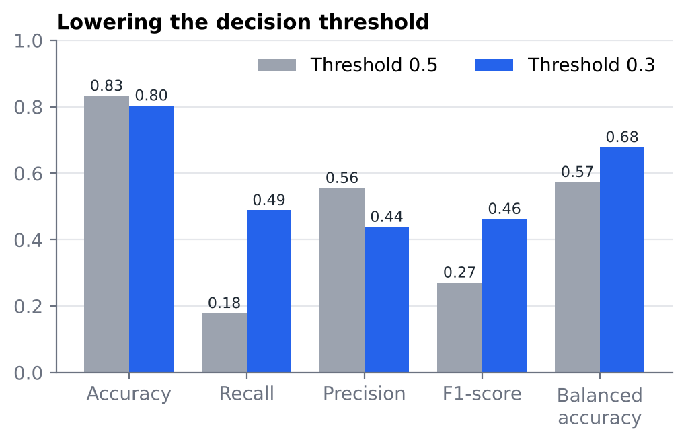
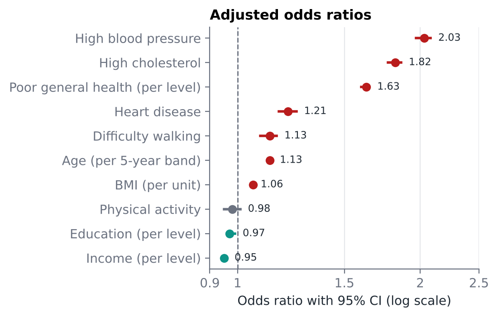

# Analysis of Diabetes Risk Factors

**Logistic regression on 229,781 survey respondents · AUC 0.80 · decision threshold tuned for 17% class imbalance**

📄 [English summary (3 pages)](diabete_summary_EN.pdf) · full report in Italian: [`diabete.pdf`](diabete.pdf)

## Research question

Which clinical, behavioural and socioeconomic characteristics are most strongly associated with diabetes, and how well can a simple, interpretable model identify people at risk when only about one respondent in six is diabetic?

## Data

- **Source:** Behavioral Risk Factor Surveillance System (BRFSS) 2015, the annual health survey of the US Centers for Disease Control and Prevention, in the public [*Diabetes Health Indicators*](https://www.kaggle.com/datasets/alexteboul/diabetes-health-indicators-dataset) release on Kaggle.
- **Size:** 253,680 records, reduced to **229,781** after removing duplicates; 21 predictors, no missing values.
- **Target:** binary. In the original three-level outcome (no diabetes / prediabetes / diabetes), prediabetes and diabetes form the positive class. Prevalence: **17.3%**.

## Methods

1. **Data cleaning** in Python (pandas): de-duplication, binary target, consistent variable names ([`data_cleaning.py`](data_cleaning.py)).
2. **Exploratory analysis** in R: distributions, group comparisons, correlation matrix.
3. **Inference:** Welch t-tests (BMI, age) and χ² tests (blood pressure, cholesterol).
4. **Model:** logistic regression with 18 predictors; multicollinearity (VIF), McFadden pseudo-R², odds ratios with 95% CIs, calibration plot and Hosmer–Lemeshow test.
5. **Evaluation:** ROC and precision–recall curves, confusion matrices at thresholds 0.5 and 0.3, 70/30 train–test split, 10-fold cross-validation.
6. **Class imbalance:** comparison of oversampling, undersampling, SMOTE and class weights.

## Key results

**1. The model ranks individuals well.** AUC = 0.80 on the full data and on the held-out test set, stable under 10-fold cross-validation. Rebalancing techniques leave the AUC at 0.80–0.81.

**2. The default threshold hides most diabetics.** At 0.5 the model reaches 83% accuracy but finds only 18% of diabetic respondents. Lowering the threshold to 0.3 raises recall to 49% and F1 from 0.27 to 0.46, for a 3-point loss in accuracy — a better trade-off for screening, where a missed case costs more than a false alarm.

<p align="center"></p>

**3. Blood pressure, cholesterol and self-rated health dominate.** Holding the other variables fixed, high blood pressure roughly doubles the odds of diabetes (OR 2.03), high cholesterol raises them by 82%, and each step of worse self-rated health by 63%. Higher income and education are mildly protective.

<p align="center"></p>

**Limitations.** The data are observational and self-reported, so the associations are not causal (the apparently protective effect of heavy drinking reflects confounding with age and BMI). Ordinal variables are coded as categories, and with n > 229,000 almost every effect is significant, so conclusions rest on effect sizes rather than p-values.

## How to reproduce

```bash
git clone https://github.com/SofiaMenegozzo/Analysis-of-Diabetes-Risk-Factors.git
cd Analysis-of-Diabetes-Risk-Factors
```

1. *(Optional — the cleaned file is already included.)* Download `diabetes_012_health_indicators_BRFSS2015.csv` from Kaggle into this folder and run `python data_cleaning.py` to regenerate `clean_diabetes_v2.csv`.
2. Install the R packages:
   ```r
   install.packages(c("tidyverse", "corrplot", "pROC", "caret", "broom", "reshape2",
                      "car", "pscl", "ResourceSelection", "PRROC", "smotefamily"))
   ```
3. Open R in this folder and run `analisi_diabete.R`. Random steps use `set.seed(123)`.

## Repository contents

| File | Description |
|---|---|
| `data_cleaning.py` | Python cleaning script |
| `clean_diabetes_v2.csv` | Cleaned dataset used by the analysis |
| `analisi_diabete.R` | Full R analysis: EDA, tests, model, evaluation, rebalancing |
| `analisi_diabete.RData` | Saved R workspace with all results |
| `diabete_summary_EN.pdf` | 3-page summary in English |
| `diabete.pdf` | Full report (Italian) |
| `figures/` | Charts used in this README |

**Tools:** Python (pandas) · R (tidyverse, caret, pROC, PRROC, smotefamily, ggplot2)

**Author:** Sofia Menegozzo
